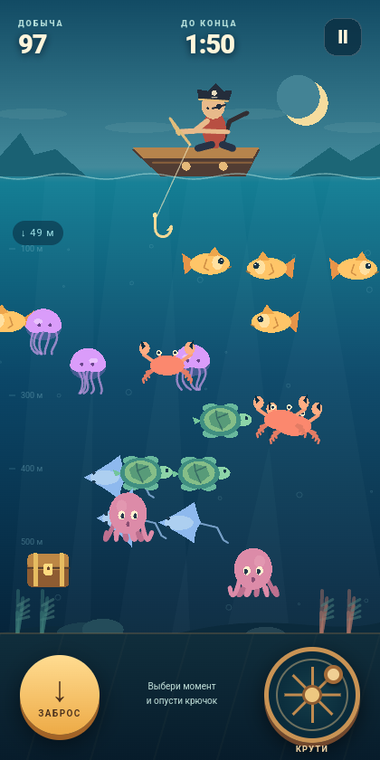

# Pirate Fishing 🎣

Пиратская рыбалка для Android. Создатель: **Mike Sokotun, школа 1288**.

## Скачать игру

**[Скачать Pirate Fishing 1.0.0 — APK](https://github.com/mikesokotun/pirate-fishing/releases/download/v1.0.0/Pirate-Fishing-1.0.0.apk)**

[Страница релиза](https://github.com/mikesokotun/pirate-fishing/releases/latest) — эту ссылку можно отправить друзьям.

Требуется **Android 6.0 или новее** с обновлённым Android System WebView. Скачайте APK на телефон и откройте файл. Если Android попросит, разрешите установку из браузера или файлового менеджера. Игра работает без интернета, рекламы и покупок. Релиз подписан для прямой установки.

## Как играть

1. Крючок равномерно качается влево-вправо. Нажмите **ЗАБРОС** слева внизу, чтобы отправить его в глубину в выбранном направлении.
2. Поймав добычу, **вращайте катушку справа по кругу** в любую сторону. Сильная добыча требует больше оборотов.
3. Чем глубже улов, тем больше очков. Очки начисляются после подъёма на поверхность. Стенки и дно возвращают пустой крючок.
4. Раунд длится **3 минуты**. Результат сохраняется автоматически; имя капитана можно изменить. В таблице остаются **20 лучших записей** на устройстве.

В море есть рыбы, медузы, крабы, черепахи, скаты, осьминоги и сундуки. Катушка щёлкает при вращении и разматывается со звуком при спуске крючка. В настройках можно отключить звук и вибрацию; там же указано авторство. При сворачивании игра ставится на паузу. Удаление приложения или его данных удалит локальные рекорды.

## Проверка

APK установлен и проверен в официальном эмуляторе **Android 15**: запуск, заброс, подъём круговым жестом, начисление очков, полный трёхминутный раунд, автоматическая запись, сохранение имени и рекорда после перезапуска, пауза при сворачивании. Проверены логика игры, компактный интерфейс и цифровая подпись APK. На физическом телефоне и отдельно на Android 6.0 проверка не проводилась.

Контрольная сумма APK находится в [SHA256SUMS.txt](SHA256SUMS.txt).
